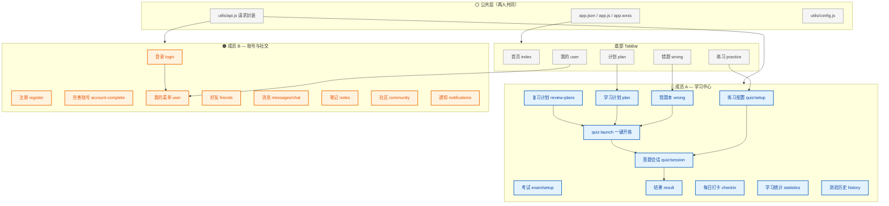
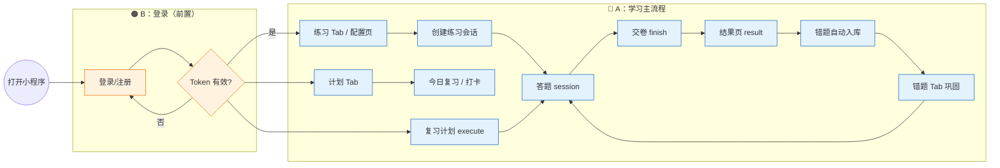
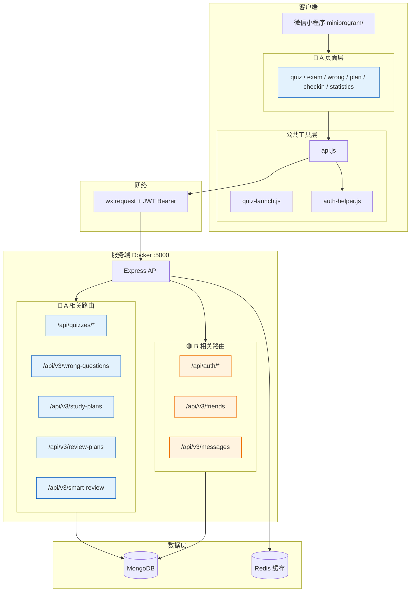
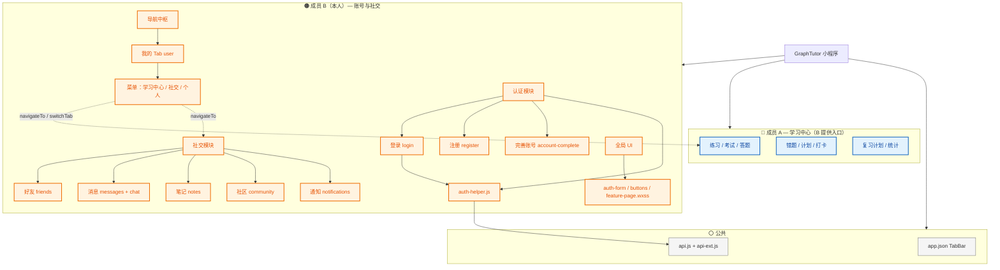
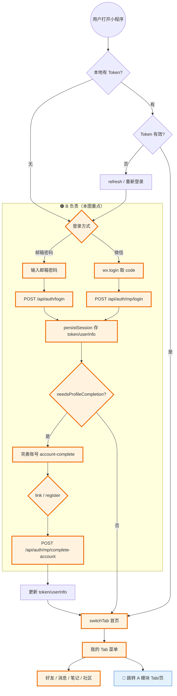
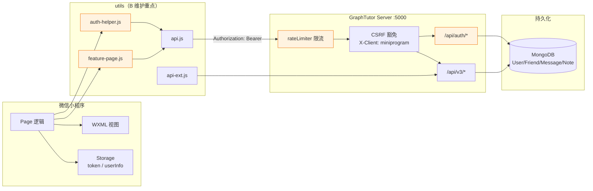
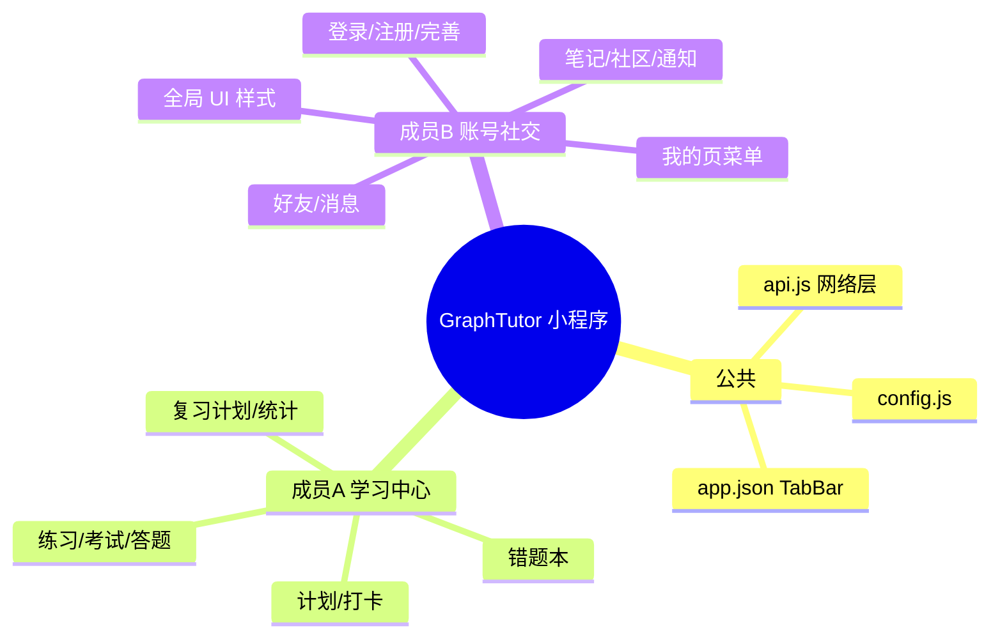
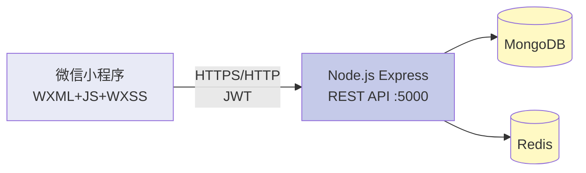

# GraphTutor 大作业配图 — 功能模块 / 业务流程 / 系统架构

> 用于报告中的 **图2 功能模块结构图**、**图3 业务流程图**、**图4 系统架构图**（成员 A / B 各一套侧重点）。  
> **用法：** 复制下方 `mermaid` 代码块 → [Mermaid Live Editor](https://mermaid.live) → 导出 PNG/SVG → 插入 Word/PDF。  
> **图例：** 🔵 蓝色 = 成员 A（学习中心）　🟠 橙色 = 成员 B（账号与社交）　⚪ 灰色 = 公共部分

---

## 成员 A 专用

### 图A-1 功能模块结构图（A/B 分工 · A 视角）

**报告位置：** 成员 A 报告「图2 / 图23」

**图下说明（可粘贴进报告）：**  
GraphTutor 小程序按 Tab 与二级页划分模块；蓝色为成员 A 负责的学习中心（练习→答题→错题→计划→打卡→复习→统计），橙色为成员 B 负责的账号与社交，灰色为公共配置与网络层。

---

### 图A-2 业务流程图（A 视角 · 学习主路径）

**报告位置：** 成员 A 报告「图3」

**讲解词（答辩）：**  
用户先经 B 模块完成登录获得 Token，再进入 A 负责的练习配置→创建会话→答题交卷→结果页；错题由后端自动写入错题本，可从错题 Tab、计划 Tab 或复习计划再次一键开练。

---

### 图A-3 系统架构图（A 视角）

**报告位置：** 成员 A 报告「图4 / 图23」

---

## 成员 B 专用

### 图B-1 功能模块结构图（标注 A/B 分工 · B 视角）

**报告位置：** 成员 B 报告「图2」

**图下说明：**  
成员 B 负责认证、我的页菜单与社交模块，并通过 `user` 页为 A 的学习中心提供统一入口；全局样式与 `feature-page` 模板保证各二级页体验一致。

---

### 图B-2 业务流程图（登录分支重点标注 · B 视角）

**报告位置：** 成员 B 报告「图3」

**讲解词（答辩）：**  
B 模块核心是登录分支：邮箱或微信获取 Token → 写入 Storage → 若需完善则进 account-complete 绑定邮箱 → 否则进首页；各页 `onShow` 通过 `ensureProfileComplete` 拦截未完善账号。

---

### 图B-3 系统架构图（B 视角 · 鉴权与社交）

**报告位置：** 成员 B 报告「图4 / 图29」

---

## 通用简版（两人报告「小组共同」章节可共用）

### 简版 · 功能模块（一张图看清 A/B）

### 简版 · 系统架构（三层）

---

## 导出为报告截图的步骤

1. 打开 https://mermaid.live  
2. 复制上面对应成员的 `mermaid` 代码块（不含 \`\`\` 标记）  
3. 粘贴到左侧编辑器 → 右侧预览  
4. **Actions → PNG/SVG** 下载  
5. Word 中：**插入 → 图片**，图下方写「图2 功能模块结构图（A/B 分工）」等  

### 建议文件名

| 成员 | 文件名建议 |
|------|------------|
| A | `图2-功能模块结构图-A.png` |
| A | `图3-业务流程图-A.png` |
| A | `图4-系统架构图-A.png` |
| B | `图2-功能模块结构图-B.png` |
| B | `图3-业务流程图-登录分支-B.png` |
| B | `图4-系统架构图-B.png` |

---

## 报告截图位对照

| 图号 | 成员 A 报告 | 成员 B 报告 |
|------|-------------|-------------|
| 图2 | 图A-1 | 图B-1 |
| 图3 | 图A-2 | 图B-2 |
| 图4 | 图A-3 | 图B-3 |
| 图23/29 | 图A-3 或简版架构 | 图B-3 或简版架构 |
